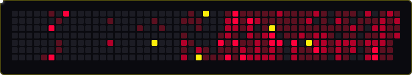

<div align="center">




<br/>


</div>


## `> whoami`

```ini
[IDENTIDADE]
handle      = Thepan808 // Kyster
funcao      = Desenvolvedor e operador solo de bots para Telegram
foco        = automacao de canais, moderacao, midia e jogos
producao    = bots proprios, mantidos e em deploy continuo
idioma      = pt-BR
```

Construo, publico e mantenho um portfolio de bots em Python, do banco de dados ao deploy. Cada projeto roda em producao, com monitoramento, tratamento de falhas e foco em estabilidade.


## `> ls ./arsenal`

<table>
<tr>
<td width="50%" valign="top">

### ▌ VERTEX
**Divulgacao e listas de canais**

Catalogo de canais com listas de divulgacao automatica, horarios e dias configuraveis, destaque exclusivo pago em Stars, painel administrativo, backup automatico e personalizacao visual completa das listas.

`Pyrogram` `asyncpg` `PostgreSQL` `Heroku`

</td>
<td width="50%" valign="top">

### ▌ SECURITY VERTEX
**Federacao e moderacao**

Sistema de federacao com fban, advertencias, apelacoes, auditoria, investigacao de usuarios, verificacao de saude dos grupos e painel web em Mini App para moderadores.

`Pyrogram` `FastAPI` `aiohttp` `PostgreSQL`

</td>
</tr>
<tr>
<td width="50%" valign="top">

### ▌ SLYVESTER CAPTIONS
**Gerenciador de canais**

Legendas, botoes e separadores automaticos em posts de canais, reacoes, encaminhamento automatico, limpeza de historico, planos free e premium com Stars.

`Pyrogram` `SQLAlchemy` `PostgreSQL` `Aiven`

</td>
<td width="50%" valign="top">

### ▌ ANTI-ENCAMINHAMENTO TAGS
**Limpeza de posts**

Remove a tag de encaminhamento e @ de outros canais, com regras por canal, excecoes por tipo de conteudo e limpeza automatica de legendas.

`Pyrogram` `Heroku Worker`

</td>
</tr>
<tr>
<td width="50%" valign="top">

### ▌ KY STUDIOS
**Midia, audio e video**

Download de YouTube, Spotify, TikTok e Instagram, edicao de tags de audio, Mini App, sala de assistir junto com sincronia em tempo real, voz e chat, alem de editor de video online.

`Pyrogram` `WebSockets` `ffmpeg` `PostgreSQL`

</td>
<td width="50%" valign="top">

### ▌ BOT WATERMARK
**Marca d'agua em midia**

Aplica marca d'agua em imagens, videos e GIFs com posicao livre, opacidade, fontes personalizadas, fila de processamento, backup por canal e assinatura via Stars.

`Pyrogram` `ffmpeg` `Pillow`

</td>
</tr>
<tr>
<td width="50%" valign="top">

### ▌ CONVERTOR
**Conversao de arquivos**

Converte documentos, imagens e videos entre formatos direto no chat, com auditoria de estabilidade em todas as categorias.

`Python` `ffmpeg`

</td>
<td width="50%" valign="top">

### ▌ MEMBER MIGRATOR
**Migracao de membros**

Gerenciamento de multiplas sessoes, login interativo dentro do bot, limites diarios por conta, agendamento automatico e controle de acesso por aprovacao.

`Pyrogram` `PostgreSQL`

</td>
</tr>
<tr>
<td width="50%" valign="top">

### ▌ QUIZ BOT
**Quiz com IA**

Geracao de perguntas por IA com fallback entre modelos, 62 categorias, progressao por XP e niveis, economia de moedas e minigame de damas completo.

`Pyrogram` `Groq API` `PostgreSQL`

</td>
<td width="50%" valign="top">

### ▌ UNO BOT
**UNO multiplayer**

Todos os modos de jogo, duplas, torneios, ranking, missoes, conquistas, apostas, painel administrativo e dashboard web jogavel.

`python-telegram-bot` `FastAPI` `PostgreSQL`

</td>
</tr>
<tr>
<td colspan="2" valign="top">

### ▌ AETHERIS RPG // NECROMANCER `[ EM DESENVOLVIMENTO ]`
**RPG de sobrevivencia**

RPG com 29 classes, mapas, aliados contratáveis, sistema de recrutamento, animacoes e versao multiplayer em desenvolvimento.

`Pyrogram` `Heroku`

</td>
</tr>
</table>


## `> cat ./stack`

<div align="center">


</div>


## `> ./stats --live`

<div align="center">


</div>


## `> ./activity --graph`

<div align="center">


<br/><br/>



</div>


